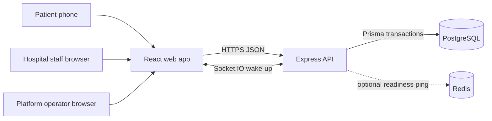
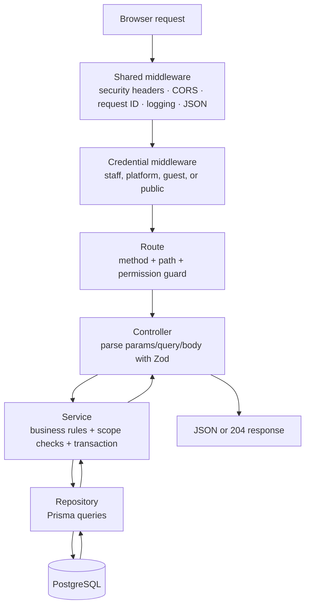
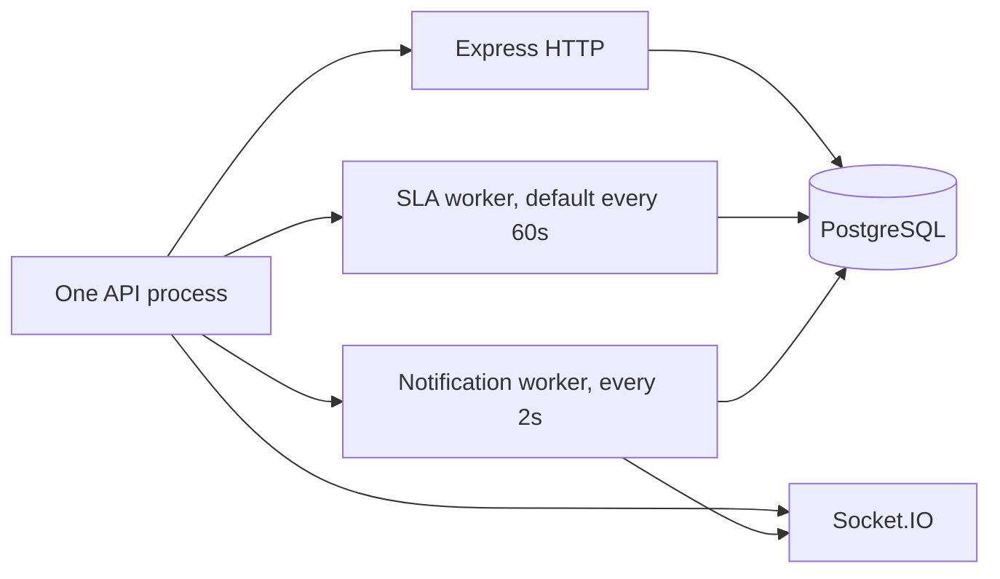
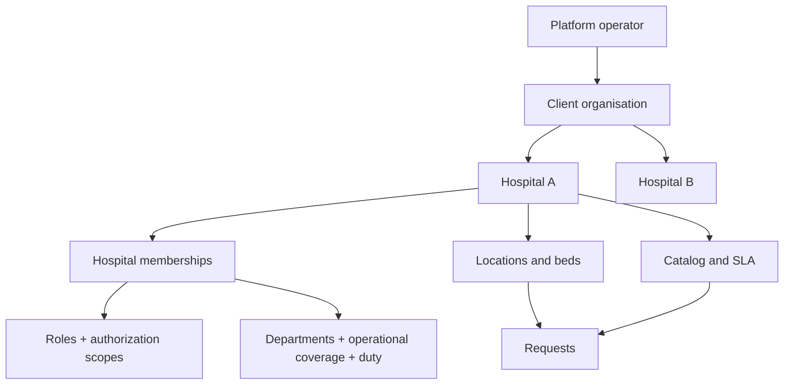
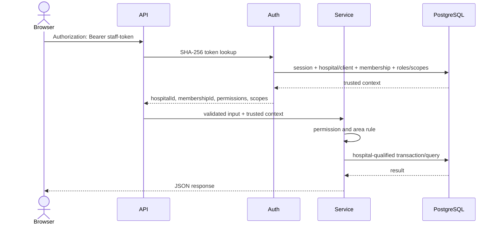
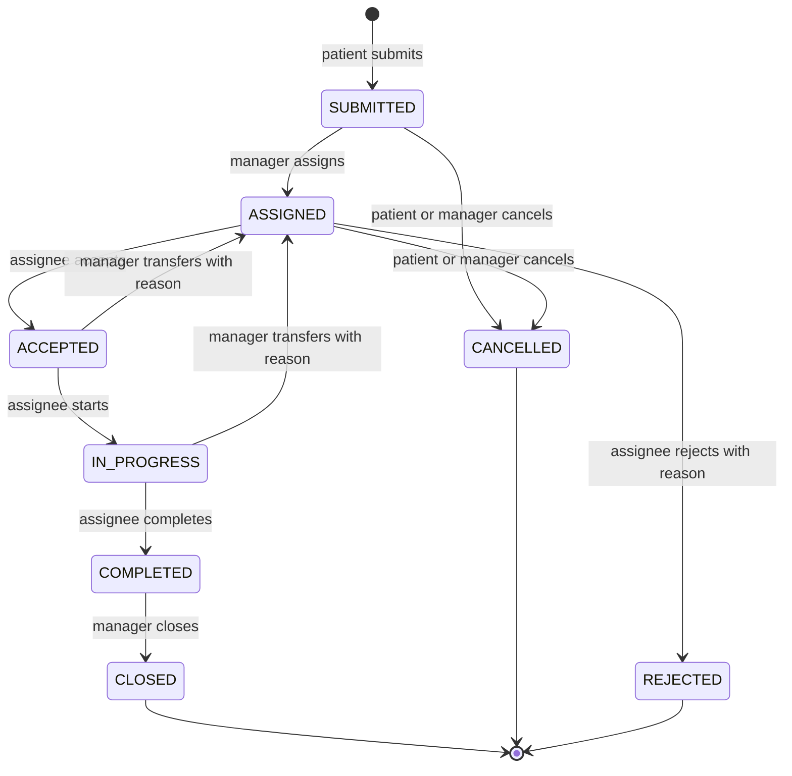
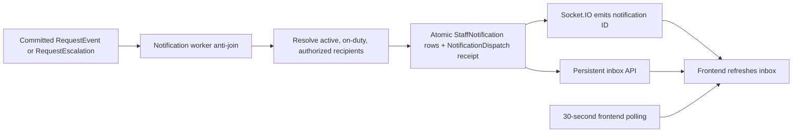
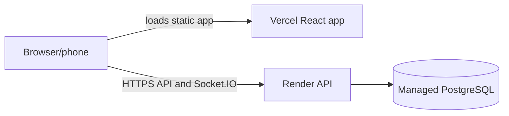

# CARE QR — complete backend handoff and rebuild guide

**Code snapshot reviewed:** 2026-10-18  
**Audience:** the project owner, a frontend developer integrating with the API, and anyone rebuilding the backend with ChatGPT in smaller, understandable steps  
**Purpose:** explain what the current project actually does, preserve the frontend contract, and provide a simpler backend rebuild plan without changing the existing application

> This guide is based on the current source code, Prisma schema, all route declarations, frontend API client/types, migrations, and automated tests. It is not a proposal pretending unfinished features already exist. Sections labelled **current system** describe the repository today; sections labelled **simpler rebuild** describe a recommended future implementation.

### How to use this guide

- To understand the product and current status, read sections 1–4.
- To explain the current backend, read sections 5–9.
- To integrate or rebuild without breaking the frontend, use sections 10–11.
- To run, test, and deploy it, use sections 12–14.
- To rebuild it with simpler code and ChatGPT, follow sections 15–17 in order.
- To hand work to another developer, finish with sections 18–21.

---

## 1. Read this first

CARE QR is a multi-hospital service-request system. A patient or attendant scans a QR code at a bed, chooses a non-emergency service, and follows the request. Hospital staff assign and complete the work. A separate platform operator onboards and manages client hospitals.

The current application is already a substantial system:

- one React/Vite frontend in `frontend/`;
- one Express/TypeScript backend in `services/`;
- one PostgreSQL database accessed through Prisma;
- 15 backend domain modules;
- 132 explicitly registered method/path endpoints;
- 38 Prisma models and 16 migrations;
- staff RBAC with hospital, floor, ward, and department scopes;
- secure QR, bed-stay, guest-session, request, report, audit, escalation, and notification flows.

The most important design rule is:

> The browser never chooses its trusted hospital. The backend derives the hospital, membership, permissions, and allowed area from the bearer session, then qualifies every hospital-owned query with that trusted hospital ID.

The current project is a **modular monolith**, not a set of microservices. That is the correct shape for this version: one backend deployment, one database, and clear domain folders.

### What is implemented now

- Platform operator sign-in, client management, hospital onboarding, hospital suspension, logos, and additional hospital managers.
- Staff sign-in, eight-hour sessions, password change/reset, roles, scoped permissions, staff status, duty, departments, coverage, and informational shifts.
- Hospital profile and location setup: optional building, floor, ward/unit, optional room, and bed/care location.
- Bed occupancy sessions, QR generation/batches/rotation/revocation, and short-lived patient guest sessions.
- Configurable patient service catalog, SLA versions, and escalation policies.
- Manual request workflow: submit, assign, accept, start, complete, close, cancel, reject, and transfer.
- Paged staff queues, alerts, reports, per-person reports, request timelines, and audit log.
- SLA escalation worker and a durable staff notification inbox with Socket.IO wake-ups plus polling recovery.
- Render/Vercel deployment configuration and GitHub Actions quality gates.

### What is not implemented or not production-proven

- Request routing is manual. `POOL`, `DIRECT`, and `AUTO_ASSIGN` exist only as future enum values; the service rejects anything other than `MANUAL`.
- No patient names or clinical record integration are stored. A `BedSession` represents an occupancy period, not a patient identity.
- No SMS, email, WhatsApp, or closed-browser Web Push.
- Shifts do not automatically put staff on or off duty.
- Redis is optional and currently used only as an optional readiness dependency. It is not a queue, cache, rate-limit store, or Socket.IO adapter.
- Workers run inside the API process and pause when the API sleeps.
- Multi-instance instant Socket.IO fan-out and shared rate limiting are not implemented.
- No completed load test, failure test, formal penetration test, staging acceptance, restore drill, or hospital pilot is established by the repository.

An early sentence in the root `README.md` says alerts and notifications remain future work. That sentence is stale. The current code and `docs/project-status.md` show that escalation alerts and the persistent notification inbox are implemented.

Some older frontend/easy-guide/final-audit pages also preserve earlier feature lists or test counts. Use the current source, migrations, tests, `docs/project-status.md`, and `docs/final-audit/14-current-platform-review.md` when they disagree.

---

## 2. Review and verification record

### Sources inspected

- `services/src/**`: composition, middleware, every domain module, background workers, seed/bootstrap code, and CLIs.
- `services/prisma/schema.prisma` and all 16 SQL migrations.
- `services/tests/unit/**`, `services/tests/integration/**`, and test fixtures.
- `frontend/src/**`: browser routes, API client, response types, permission-aware navigation, and all feature areas.
- `frontend/tests/**` and `frontend/e2e/**`.
- `.github/workflows/ci.yml`, `render.yaml`, `frontend/vercel.json`, and environment examples.
- Existing architecture, deployment, audit, ER, and testing documentation.

### Checks run during this review

The passing command runs below used the repository-pinned Node.js `24.19.0` runtime.

| Check | Result on 2026-10-18 |
|---|---|
| Backend format check | Passed |
| Backend lint, zero warnings allowed | Passed |
| Backend TypeScript check | Passed |
| Backend unit tests | **37/37 passed** across 8 files |
| Backend production build | Passed |
| Prisma schema validation | Passed |
| Generated ER diagram drift check | Passed |
| Frontend format check | Passed |
| Frontend lint, zero warnings allowed | Passed |
| Frontend TypeScript check | Passed |
| Frontend interaction tests | **127/127 passed** across 21 files |
| Frontend production build | Passed |

`TEST_DATABASE_URL` was not configured in this workspace, so this review did not run database integration tests or Playwright end-to-end tests. They intentionally refuse to use the normal development database. The latest repository-recorded isolated-database run, dated 2026-10-12, reports **171 backend integration tests** and **17 Chromium end-to-end tests** passing. Treat that as prior evidence, not as a fresh run on 2026-10-18.

Node 20 is not sufficient for the installed test/build toolchain. Always run `nvm use` first; the default shell in this workspace was Node 20 and Vitest failed before tests started until Node 24 was put first on `PATH`.

---

## 3. Product actors and trust boundaries

| Actor | Entry point | Credential | May access |
|---|---|---|---|
| Patient or attendant | `/`, `/q/:token`, `/patient` | Short-lived guest bearer token issued after QR resolution | One active bed stay, visible service catalog, and requests for that stay |
| Hospital staff | `/login`, `/admin/*` | Staff bearer token tied to one hospital membership | Only permissions and scopes derived from active roles in that hospital |
| Platform operator | `/platform/login`, `/platform/*` | Separate platform bearer token | Clients and hospitals, but not hospital requests or patient workflows |

These three credentials use different database tables and cannot be substituted for each other:

| Credential domain | Session table | Lifetime | Browser storage |
|---|---|---:|---|
| Staff | `StaffSession` | 8 hours | `localStorage` key `careqr.staffToken` |
| Platform | `PlatformSession` | 8 hours | `localStorage` key `careqr.platformToken` |
| Patient guest | `GuestSession` | default 120 minutes, configurable | `sessionStorage` key `careqr.guestToken` |

Every raw bearer token is 256 random bits encoded as a 43-character Base64URL string. Only a SHA-256 hash is stored in PostgreSQL. Passwords use Node's `scrypt` with a random 32-byte salt. Sign-in also performs a dummy password check for unknown accounts so timing does not reveal whether a hospital code or email exists.

---

## 4. Technology and repository map

### Technology choices

| Concern | Current choice |
|---|---|
| Backend runtime | Node.js 24, TypeScript, ESM |
| HTTP API | Express 5 |
| Validation | Zod |
| Database | PostgreSQL 17+ |
| ORM/migrations | Prisma 6.19 |
| Logging | Pino / pino-http |
| Realtime wake-up | Socket.IO |
| Frontend | React 19, React Router, Vite |
| Unit/component tests | Vitest |
| HTTP integration tests | Supertest + real PostgreSQL |
| Browser tests | Playwright + Chromium |
| Backend hosting config | Render |
| Frontend hosting config | Vercel |
| CI | GitHub Actions with PostgreSQL 17 |

### Repository layout

```text
QR_Hospital_management/
├── .github/workflows/ci.yml       automated quality gates
├── docs/                          architecture, guides, audits, ER diagram
├── frontend/                      React web app
│   ├── src/api/                   backend client and response types
│   ├── src/features/              screens grouped by product area
│   ├── src/lib/                   shared browser helpers
│   ├── tests/                     Vitest interaction tests
│   └── e2e/                       Playwright whole-system tests
├── services/                      Express backend
│   ├── prisma/
│   │   ├── schema.prisma          current database model
│   │   └── migrations/            16 ordered SQL migrations
│   ├── src/
│   │   ├── server.ts              process startup, workers, shutdown
│   │   ├── app.ts                 Express middleware and route mounting
│   │   ├── container.ts           constructs modules and route groups
│   │   ├── common/                errors, tokens, shared validation, time zones
│   │   ├── config/                environment parsing and logger
│   │   ├── database/              Prisma and optional Redis clients
│   │   ├── http/                  health routes and generic CRUD adapter
│   │   ├── middleware/            auth, CORS, rate limits, errors, request ID
│   │   ├── modules/               business domains
│   │   ├── cli/                   bootstrap, seed, and ER commands
│   │   └── seeds/                 demo/test data builders
│   └── tests/                     unit and integration tests
├── render.yaml                    Render backend blueprint
└── .nvmrc                         Node 24.19.0
```

---

## 5. Current architecture

### 5.1 System context



PostgreSQL is the source of truth. Redis may be absent without losing application behavior.

### 5.2 How one backend request travels



The current backend uses five domain layers:

| Layer | Responsibility |
|---|---|
| `*.routes.ts` | HTTP method, URL, and route permission |
| `*.controller.ts` | HTTP parsing, schema validation, status code, response envelope |
| `*.schemas.ts` | Zod input contracts and inferred types |
| `*.service.ts` | business rules, authorization scope, transactions, audit coupling |
| `*.repository.ts` | Prisma reads/writes and row-lock queries |

This separation is consistent and safe, but it creates many files. The later **simpler rebuild** section keeps the same business rules with fewer layers.

### 5.3 Route groups

`services/src/container.ts` creates every service/controller and returns three groups:

```text
root    /auth/staff/*, /auth/platform/*, /platform/*
admin   /admin/*    — staff authentication mounted once before all module routes
public  /public/*   — QR, logos, and patient routes; guest auth applied per route
```

`services/src/app.ts` mounts health routes first, then these groups, then a 404 handler and one centralized error handler.

### 5.4 Runtime processes



The database makes duplicate escalation/notification processing safe, but Socket.IO rooms are process-local. Horizontal scaling needs a shared adapter and shared rate limiter before it can promise instant multi-instance delivery.

---

## 6. Backend module catalog

| Module | Owns/explains | Main tables | Main route prefix |
|---|---|---|---|
| `auth` | Staff login, logout, password change, staff context and scope helpers | `User`, `StaffSession` reads/writes | `/auth/staff` |
| `platform` | Platform login, clients, hospitals, suspension, managers | `Client`, `PlatformSession`; coordinates hospital onboarding | `/auth/platform`, `/platform` |
| `hospitals` | Hospital profile, bootstrap, logo, open/closed check | `Hospital`, `HospitalLogo` | `/admin/hospital`, `/public/logos` |
| `roles` | Permission catalog, built-in/custom roles, scoped role assignments | `Permission`, `Role`, `RolePermission`, `UserRole`, `ScopeAssignment` | `/admin/roles`, `/admin/memberships` |
| `departments` | Editable operational teams | `Department` | `/admin/departments` |
| `staff` | Staff records, status, duty, departments, coverage, shifts, eligibility | `User`, `HospitalMembership`, `StaffDepartment`, `StaffLocationScope`, `Shift` | `/admin/staff`, `/admin/shifts` |
| `locations` | Building/floor/ward/room/bed hierarchy and bed occupancy helpers | `Building`, `Floor`, `Ward`, `Room`, `Bed` | `/admin/buildings` through `/admin/beds` |
| `bed-sessions` | Bed occupancy/admission periods and patient guest sessions | `BedSession`, `GuestSession` | `/admin/bed-sessions`, `/public/session` |
| `qr` | QR issue, batch issue, rotate, revoke, and resolve | `BedQrCode` | `/admin/qr-codes`, `/admin/beds/:id/qr`, `/public/qr` |
| `catalog` | Patient categories/services and immutable request snapshot input | `ServiceCategory`, `ServiceItem` | `/admin/service-categories`, `/admin/services`, `/public/services` |
| `sla` | Versioned response targets and escalation configuration | `SlaPolicy`, `SlaPolicyVersion`, `EscalationPolicy`, `EscalationLevel` | `/admin/sla-policies`, `/admin/escalation-policies` |
| `requests` | Request state machine, queue, alerts, events, escalation execution | `ServiceRequest`, `RequestEvent`, `RequestEscalation` | `/admin/requests`, `/public/requests` |
| `notifications` | Durable personal inbox, recipient resolution, realtime wake-up | `StaffNotification`, `NotificationDispatch` | `/admin/notifications`, `/socket.io` |
| `reports` | Request summaries, log, timeline, person report | read-only | `/admin/reports` |
| `audit` | Transaction-coupled audit writes and readable audit feed | `AuditLog` | `/admin/audit-log` |

Cross-module imports go through the owning module's `index.ts`. Repositories stay private. ESLint enforces several of these boundaries.

---

## 7. Tenancy, roles, permissions, and eligibility

### 7.1 SaaS hierarchy



A hospital is open only when both its `Hospital.status` and its parent `Client.status` are active.

### 7.2 Authorization scope is not operational coverage

These two concepts must remain separate:

- `ScopeAssignment`: where a role's permissions apply. This decides what a person is allowed to read or change.
- `StaffLocationScope` plus `StaffDepartment` plus `dutyStatus`: where a person can operationally receive work.

A person may be authorized to manage a floor without being eligible to perform Pantry work there. Conversely, coverage does not grant a permission.

### 7.3 Built-in roles

| Built-in role | Scope level | Intended access |
|---|---|---|
| Hospital Manager | Hospital | Every permission; locked and the hospital must retain at least one active holder |
| Floor Manager | Floor | Area locations/beds/sessions, staff read, request read/assign/transfer/cancel/close, analytics |
| Ward Manager | Ward | Same management permissions within one ward/unit |
| Department Supervisor | Department | Staff read and request/analytics management for one department |
| Care Staff | Hospital scope assignment | Only assigned request read plus accept/start/complete/reject actions |

### 7.4 Permission catalog

```text
hospital.read          hospital.manage
role.read              role.manage
location.read          location.manage
bed.read               bed.manage
qr.generate            qr.rotate              qr.revoke
bedSession.manage
staff.read              staff.manage
service.read            service.manage
request.read            request.assign         request.accept
request.start           request.complete       request.close
request.transfer        request.cancel         request.reject
routing.manage
sla.manage
audit.read
analytics.read
```

`routing.manage` exists for planned routing configuration, but no routing-rule implementation exists today.

### 7.5 Staff eligibility formula

A person is eligible to receive a request only when all are true:

```text
active User
AND active HospitalMembership
AND dutyStatus = ON_DUTY
AND member of the request's Department
AND coverage contains the bed's hospital OR floor OR ward
```

Assignment and acceptance recalculate eligibility from trusted database data. A scheduled `Shift` does not affect eligibility in V1.

Eligibility alone does not grant request permissions. In particular, an operationally eligible person can be selected for assignment even if their roles do not include `request.accept`; that person would then be unable to accept until their authorization is corrected. A simpler rebuild should either preserve this exact contract or deliberately tighten assignment and update the frontend/tests together.

### 7.6 Security rules that must never be removed

1. Derive `hospitalId` from the authenticated session; do not accept it as authority from a request body.
2. Qualify hospital data by `hospitalId`, including direct ID lookups.
3. Return `404`, not a revealing cross-tenant message, for inaccessible records.
4. Check both route permission and record/area scope in the service.
5. Do not let a role manager grant permissions they do not hold hospital-wide.
6. Do not let the last active Hospital Manager be removed or deactivated.
7. Keep staff, guest, and platform token domains separate.
8. Never log authorization headers, request bodies, QR tokens, passwords, or query values.

---

## 8. Database model and invariants

### 8.1 Model groups

The full field-level source of truth is `services/prisma/schema.prisma`; the generated relationship view is `docs/database/er-diagram.md`.

| Group | Models | Meaning |
|---|---|---|
| SaaS | `Client`, `Hospital`, `HospitalLogo`, `HospitalSetting` | Customer organisation, its hospitals, database-stored branding, and future settings |
| Identity | `User`, `PlatformAdmin`, `PlatformSession`, `HospitalMembership`, `StaffSession` | Global login identity, separate platform/staff access, and hospital membership |
| Authorization | `Role`, `Permission`, `RolePermission`, `UserRole`, `ScopeAssignment` | RBAC and where each assigned role applies |
| Staff operations | `Department`, `StaffDepartment`, `StaffLocationScope`, `Shift` | Team membership, work coverage, duty scheduling information |
| Locations | `Building`, `Floor`, `Ward`, `Room`, `Bed` | Hospital care-location hierarchy; building and room are optional |
| QR and stays | `BedQrCode`, `BedSession`, `GuestSession` | Printed access secret, occupancy period, and short-lived patient access |
| Catalog and SLA | `ServiceCategory`, `ServiceItem`, `SlaPolicy`, `SlaPolicyVersion`, `EscalationPolicy`, `EscalationLevel` | Patient choices, owning team, deadlines, and escalation chain |
| Requests | `ServiceRequest`, `RequestEvent`, `RequestEscalation` | Current request snapshot, immutable history, and executed SLA steps |
| Notifications | `StaffNotification`, `NotificationDispatch` | Personal durable inbox and exactly-once source processing receipt |
| Accountability | `AuditLog` | Who changed configuration/work and what changed |

### 8.2 Location hierarchy

```text
Hospital
└── Building?             optional
    └── Floor             required
        └── Ward / Unit   required
            └── Room?     optional
                └── Bed / care location
```

The `Bed` model also represents cots, chairs, trolleys, dialysis chairs, and other care locations. Intensive-care unit types are deliberately unsupported for bedside QR service requests.

### 8.3 Important database-enforced rules

Several critical rules live in migration SQL because Prisma cannot express them all:

- At most one active `BedSession` per bed.
- Active/closed bed-session timestamps and active/revoked QR timestamps must agree with status.
- Staff coverage rows must have the correct floor/ward shape; only one hospital-wide coverage row per member.
- Shifts must end after they start.
- SLA minutes are bounded and completion cannot be earlier than acceptance.
- `SlaPolicyVersion` rows cannot be updated; a trigger makes them immutable.
- Escalation target/role shape and ordered values are constrained.
- One active request for the same service, bed session, and hospital is allowed at a time.
- `RequestEvent` rows cannot be updated or deleted; a trigger makes history append-only.
- Request events are unique per request version.
- Floor codes are unique inside a building and separately among floors with no building.
- Hospital logo MIME type, byte size, and actual byte length are constrained.
- Notifications are deduplicated by hospital, recipient, and source key.
- Most ownership relationships use composite `(hospitalId, id)` foreign keys and `ON DELETE RESTRICT`.

### 8.4 Important application-enforced rules

- Active child locations require active parents.
- Occupied status changes only through the bed-session workflow.
- QR rotation/revocation and bed-session close revoke affected guest sessions in the same transaction.
- Role/permission privilege ceilings and last-manager protection.
- Staff status, duty, password-reset, and cross-account restrictions.
- Expected request version, legal request transition, actor ownership, and assignee eligibility.
- Audit rows are written in the same transaction as significant changes.

### 8.5 Deliberate future-facing fields

Do not mistake these schema fields for completed features:

- `HospitalSetting` is currently used only by demo/test seed data.
- `StaffSession.lastSeenAt` is initialized but not updated.
- `AssignmentMode` includes `POOL`, `DIRECT`, and `AUTO_ASSIGN`, and `ServiceRequest.routingRuleId` exists, but only `MANUAL` is accepted and there is no `RoutingRule` model.
- `Shift` is informational only.
- Generic notification entity/source identifiers are scalar historical references, not foreign keys. Request visibility is rechecked before returning an inbox link.

---

## 9. Main business flows

### 9.1 Hospital onboarding

One transaction creates or selects the client, creates the hospital, creates the first manager account/membership, ensures the permission catalog, creates built-in roles, grants Hospital Manager at hospital scope, creates example departments, creates example catalog/SLA data, optionally stores a logo, and writes a system audit entry. Any failure rolls the whole onboarding back.

New hospitals receive editable example data, not hard-coded behavior:

- Departments: Nursing, Housekeeping, Pantry, Maintenance, Patient Assistance, Billing, Transport.
- Categories: Food & Water, Nursing Help, Room & Cleaning, Assistance.
- Services: Drinking Water, Nurse Assistance, Room Cleaning, Wheelchair.
- SLA examples: Quick response (3/10 minutes) and Standard (10/60 minutes).

### 9.2 Staff authenticated request



### 9.3 Bed stay and QR flow

```mermaid
sequenceDiagram
  actor Manager
  actor Patient
  participant API
  participant DB as PostgreSQL
  Manager->>API: POST /admin/bed-sessions {bedId}
  API->>DB: AVAILABLE -> OCCUPIED + ACTIVE BedSession + audit
  Manager->>API: POST /admin/beds/:id/qr
  API->>DB: store only SHA-256(token)
  API-->>Manager: raw token + printable URL once
  Patient->>API: POST /public/qr/resolve {token}
  API->>DB: lock QR; verify open hospital, active bed, active stay
  API->>DB: create expiring GuestSession with hashed token
  API-->>Patient: guest token + location
```

Rotating or revoking a QR ends all guest sessions opened for that bed. Closing a bed session ends guest sessions for that stay and returns the bed to `AVAILABLE`.

### 9.4 Patient request submission

Inside one transaction the backend:

1. locks and rechecks the active bed session and guest session;
2. verifies the hospital/client, bed, category, department, and service are active;
3. snapshots service name, category, department, priority, exact SLA version, minutes, deadlines, and optional escalation policy;
4. creates `ServiceRequest` in `SUBMITTED`, version `1`;
5. creates the first append-only `RequestEvent`.

Retrying the same active service for the same stay returns the existing request. A partial unique index also prevents racing duplicates.

### 9.5 Request state machine



Every staff command includes `expectedVersion`. The update succeeds only if both the current version and current status still match. A stale browser receives `409 CONFLICT` instead of overwriting newer work. Every successful command increments the version and adds exactly one event.

Command bodies:

| Command | Allowed from | Body beyond `expectedVersion` | Extra actor rule |
|---|---|---|---|
| `assign` | `SUBMITTED` | `assigneeId` | assignee must currently be eligible |
| `accept` | `ASSIGNED` | — | caller must be current assignee and still eligible |
| `start` | `ACCEPTED` | — | caller must be current assignee |
| `complete` | `IN_PROGRESS` | — | caller must be current assignee |
| `close` | `COMPLETED` | — | scoped manager permission |
| `cancel` | `SUBMITTED`, `ASSIGNED` | `reason` | scoped manager; guest has a separate endpoint |
| `reject` | `ASSIGNED` | `reason` | caller must be current assignee |
| `transfer` | `ACCEPTED`, `IN_PROGRESS` | `assigneeId`, `reason` | new assignee must differ and be eligible |

### 9.6 SLA and escalation flow

Both deadlines are measured from submission:

```text
acceptDueAt   = submittedAt + acceptMinutes
completeDueAt = submittedAt + completeMinutes
```

Changing SLA timings creates a new immutable version. Existing requests keep their copied version and deadlines.

The escalation worker runs inside the API process, normally every 60 seconds:

- acceptance stage: `SUBMITTED` or `ASSIGNED` past `acceptDueAt`;
- completion stage: `ACCEPTED` or `IN_PROGRESS` past `completeDueAt`;
- each configured level runs once per request/stage/level;
- a row lock rechecks current state before writing;
- a unique database key prevents duplicates across restarts or multiple workers;
- each action records `RequestEscalation`, request flags, and a system audit.

### 9.7 Notification flow



Socket.IO is a wake-up signal, not the source of truth. The message contains only a notification ID. If realtime is missed, the persistent inbox and 30-second polling recover it. Marking a notification read never changes request state.

### 9.8 Reports and audit

- Reports read `ServiceRequest` plus ordered `RequestEvent` history and calculate outcomes/actions in application memory.
- Report days use the hospital's IANA time zone, not the server or viewer time zone.
- A summary reads at most 20,000 source requests; the detailed log returns at most 2,000 rows and says when results are truncated.
- Audit writes are coupled to the business transaction. The read API converts stored IDs/metadata into human-readable names and before/after fields.

---

## 10. HTTP contract

### 10.1 Base URL

- Backend paths below are the real Express paths, such as `/admin/requests`.
- In local development, the frontend calls `/api/admin/requests`; Vite removes `/api` and proxies to `http://localhost:3001`.
- In production, `VITE_API_URL` is the API origin and the frontend calls the backend paths directly. Do not append `/api` unless a separate reverse proxy is deliberately configured that way.

### 10.2 General request rules

- JSON body limit: 1 MB.
- Logo upload: raw PNG/JPEG/WebP bytes, maximum 1 MB; type is detected from bytes.
- All non-GET/HEAD query strings must be empty.
- Zod schemas are strict: unknown body/query fields are rejected.
- Protected requests use `Authorization: Bearer <43-character-token>`.
- IDs are UUIDs except public request references such as `CR-0123ABCDEF456789`.
- Dates/times in JSON are ISO 8601 strings.
- Enum values are uppercase exactly as documented.
- `204` responses have no JSON body.
- All API/session/error responses default to `Cache-Control: no-store`; versioned public logos explicitly use immutable caching.

### 10.3 Error envelope

```json
{
  "error": {
    "code": "VALIDATION_ERROR",
    "message": "Human-readable explanation.",
    "fields": ["optional", "field", "paths"],
    "requestId": "correlation-id"
  }
}
```

| HTTP | Common code | Meaning |
|---:|---|---|
| 400 | `VALIDATION_ERROR`, `INVALID_JSON` | malformed or rule-breaking input |
| 401 | `UNAUTHORIZED` | missing, invalid, expired, revoked, or inactive credential/context |
| 403 | `FORBIDDEN` | authenticated but permission/action is not allowed |
| 403 | `PASSWORD_CHANGE_REQUIRED` | administrator reset; only `/me`, password change, and logout are allowed |
| 404 | `NOT_FOUND` | missing or inaccessible record |
| 404 | `QR_UNAVAILABLE` | one generic response for invalid/revoked/inactive/no-stay QR cases |
| 409 | `CONFLICT` | stale version, duplicate, protected dependency, or illegal current state |
| 413 | `PAYLOAD_TOO_LARGE` | body exceeds limit |
| 429 | `RATE_LIMITED` | in-process rate limit exceeded |
| 500 | `INTERNAL_SERVER_ERROR` | safe generic unexpected error |
| 503 | `SERVICE_UNAVAILABLE` | readiness dependency failed/timed out |

### 10.4 Endpoint count

The current backend registers **132 explicit method/path combinations**:

| Area | Count |
|---|---:|
| Health/root | 3 |
| Staff authentication | 4 |
| Platform authentication | 3 |
| Platform client/hospital management | 10 |
| Hospital profile/public logo | 5 |
| Standard CRUD resources | 55 |
| Role assignment and bulk locations | 4 |
| Staff and shifts | 14 |
| Bed/guest sessions | 4 |
| QR | 6 |
| Public service catalog | 1 |
| Staff/public requests | 15 |
| Reports | 4 |
| Audit | 1 |
| Notifications | 3 |
| **Total** | **132** |

### 10.5 Public health and auth endpoints

| Method | Path | Auth | Input | Success |
|---|---|---|---|---|
| GET | `/` | public | no query | `200 {service,status,health,requestId}` |
| GET | `/health` | public | no query | `200 {status,requestId}`; liveness only |
| GET | `/ready` | public | no query | `200` with dependency states, or `503` |
| POST | `/auth/staff/login` | public, rate-limited | `{hospitalCode,email,password}` | `200 {token,expiresAt}` |
| GET | `/auth/staff/me` | staff | no query | `200` user, membership, tenant, permissions/scopes |
| POST | `/auth/staff/logout` | staff | `{}` or no body | `204` |
| POST | `/auth/staff/password` | staff | `{currentPassword,newPassword}` | `204`; other sessions end |
| POST | `/auth/platform/login` | public, rate-limited | `{email,password}` | `200 {token,expiresAt}` |
| GET | `/auth/platform/me` | platform | no query | `200 {user}` |
| POST | `/auth/platform/logout` | platform | `{}` or no body | `204` |

Staff login limits are 10 attempts per account/address combination in 15 minutes and 120 attempts per address per minute. Password-change guesses are limited to 10 per membership in 15 minutes. Platform login and QR resolve use separate in-process limits configured at composition time.

### 10.6 Platform endpoints

All require a platform token.

| Method | Path | Purpose / key input |
|---|---|---|
| GET | `/platform/clients` | list clients with aggregate counts |
| GET | `/platform/clients/:id` | client detail and hospitals |
| PATCH | `/platform/clients/:id` | name/contact/status; nullable contact fields clear values |
| GET | `/platform/hospitals` | list hospitals |
| POST | `/platform/hospitals` | create hospital + first manager; use `clientId`, nested `client`, or neither |
| GET | `/platform/hospitals/:id` | hospital detail/managers/counts |
| PATCH | `/platform/hospitals/:id` | name, timezone, status, or owning `clientId` |
| PUT | `/platform/hospitals/:id/logo` | raw image body; returns `{logoUrl}` |
| DELETE | `/platform/hospitals/:id/logo` | remove logo; `204` |
| POST | `/platform/hospitals/:id/managers` | `{displayName,email,password}`; `201 {hospital}` |

Creating a hospital requires `name`, `code`, `timezone`, `managerName`, `managerEmail`, and a password of at least 12 characters. Suspending a client/hospital revokes affected staff sessions and prevents patient access while retaining data.

### 10.7 Standard CRUD endpoints

Each resource below has exactly five endpoints:

```text
GET    /admin/<resource>       -> 200 {<pluralKey>: [...]}
GET    /admin/<resource>/:id   -> 200 {<singularKey>: {...}}
POST   /admin/<resource>       -> 201 {<singularKey>: {...}}
PATCH  /admin/<resource>/:id   -> 200 {<singularKey>: {...}}
DELETE /admin/<resource>/:id   -> 204
```

| Resource | List filters | Create/update fields | Read / manage permission |
|---|---|---|---|
| `buildings` | `active` | `code`, `name`, later `active` | scoped `location.read` / hospital `location.manage` |
| `floors` | `buildingId`, `active` | `buildingId`, `code`, `name`, `level`; update cannot move building | scoped `location.read` / hospital `location.manage` |
| `wards` | `floorId`, `active` | `floorId`, `code`, `name`, `unitType`; update cannot move floor | scoped `location.read` / hospital `location.manage` |
| `rooms` | `wardId`, `active` | `wardId`, `code`, `name`, `roomType`; update cannot move ward | scoped `location.read` / hospital `location.manage` |
| `beds` | `wardId`, `roomId`, `status`, `active` | `wardId`, optional `roomId`, `code`, `displayName`, `bedType`; update safe status/active fields | scoped `bed.read` / hospital `bed.manage` |
| `departments` | `active` | `code`, `name`, later `active` | `staff.read` / `staff.manage` |
| `service-categories` | `active` | `name`, optional description/sort/emergency notice; later `active` | `service.read` / `service.manage` |
| `services` | `categoryId`, `departmentId`, `active` | category, department, SLA, optional escalation, name, description, priority, sort; later `active` | `service.read` / `service.manage` |
| `sla-policies` | none | `name`, `acceptMinutes`, `completeMinutes` | `service.read` / `sla.manage` |
| `escalation-policies` | none | `name`, ordered `levels` targeting `ASSIGNEE` or `ROLE` | `service.read` / `sla.manage` |
| `roles` | none | `name`, description, scope level, permission keys, active | `role.read` / `role.manage` |

List response keys are `buildings`, `floors`, `wards`, `rooms`, `beds`, `departments`, `serviceCategories`, `services`, `slaPolicies`, `escalationPolicies`, and `roles`. Item keys are the singular equivalent.

Codes are trimmed, converted to uppercase, 1–32 characters, and limited to letters, numbers, dot, underscore, and hyphen. Most names are trimmed one-line text up to 120 characters. Update bodies must contain at least one recognized field.

### 10.8 Hospital, role-assignment, location, staff, and shift endpoints

All paths require staff auth plus the stated permission.

| Method | Path | Input / behavior | Permission |
|---|---|---|---|
| GET | `/admin/hospital` | current session hospital | `hospital.read` |
| PATCH | `/admin/hospital` | `{name?,timezone?}` | `hospital.manage` |
| PUT | `/admin/hospital/logo` | raw image | `hospital.manage` |
| DELETE | `/admin/hospital/logo` | remove; `204` | `hospital.manage` |
| GET | `/public/logos/:publicId` | public immutable binary image | public |
| POST | `/admin/memberships/:id/roles` | `{roleId,scopeId?}` | `staff.manage` + `role.manage` |
| DELETE | `/admin/memberships/:id/roles/:roleId` | remove role everywhere | same |
| DELETE | `/admin/memberships/:id/roles/:roleId/scopes/:scopeId` | remove one scope | same |
| POST | `/admin/wards/:id/bulk-beds` | numbered beds, or rooms with beds; atomic | `bed.manage`; room mode also `location.manage` |
| GET | `/admin/staff` | filters: status, dutyStatus, departmentId | `staff.read` |
| GET | `/admin/staff/eligible` | `bedId`, `departmentId` | scoped `staff.read` and target area validation |
| GET | `/admin/staff/:id` | staff detail | `staff.read` |
| POST | `/admin/staff` | `{email,displayName,password}` | `staff.manage` |
| POST | `/admin/staff/:id/status` | `{status}` | `staff.manage` + privilege ceiling |
| POST | `/admin/staff/:id/password` | `{temporaryPassword}` | `staff.manage`; target must change it |
| POST | `/admin/staff/:id/duty` | `{dutyStatus}` | `staff.manage` |
| POST | `/admin/staff/:id/departments` | `{departmentId}` | `staff.manage` |
| DELETE | `/admin/staff/:id/departments/:departmentId` | returns updated staff | `staff.manage` |
| POST | `/admin/staff/:id/coverage` | hospital, floor, or ward discriminated body | `staff.manage` |
| DELETE | `/admin/staff/:id/coverage/:coverageId` | returns updated staff | `staff.manage` |
| GET | `/admin/shifts` | optional membershipId/from/to | `staff.read` |
| POST | `/admin/shifts` | membership, optional department, startsAt, endsAt | `staff.manage` |
| DELETE | `/admin/shifts/:id` | `204` | `staff.manage` |

Bulk limits are 300 direct beds or 100 rooms with at most 12 beds per room. The whole bulk operation succeeds or fails as one transaction.

Logo URLs returned by the API are relative backend paths such as `/public/logos/<uuid>`. The frontend resolves them against the API origin, not the Vercel page origin.

### 10.9 Bed session and QR endpoints

| Method | Path | Auth | Input / success |
|---|---|---|---|
| GET | `/admin/bed-sessions` | staff, scoped `bed.read` | optional `bedId`, `status`; `{bedSessions}` |
| POST | `/admin/bed-sessions` | staff, scoped `bedSession.manage` | `{bedId}`; `201 {bedSession}` |
| POST | `/admin/bed-sessions/:id/close` | same | `{}`; `200 {bedSession}` |
| GET | `/public/session` | guest | `{location}` |
| GET | `/admin/qr-codes` | staff, scoped `bed.read` | optional `bedId`; `{qrCodes}` |
| POST | `/admin/qr-codes/batch` | hospital manager + QR permission | `{scope,replaceExisting}`; `201` batch issues |
| POST | `/admin/beds/:id/qr` | `hospital.manage` + `qr.generate` | `{}`; `201 {qrCode,token,url}` |
| POST | `/admin/beds/:id/qr/rotate` | `hospital.manage` + `qr.rotate` | `{}`; new one-time token |
| POST | `/admin/beds/:id/qr/revoke` | `hospital.manage` + `qr.revoke` | `{}`; `{qrCode}` |
| POST | `/public/qr/resolve` | public, rate-limited | `{token}`; `201 {guestToken,expiresAt,location}` |

A batch scope is one of:

```json
{ "kind": "HOSPITAL" }
{ "kind": "BUILDING", "id": "uuid" }
{ "kind": "FLOOR", "id": "uuid" }
{ "kind": "WARD", "id": "uuid" }
{ "kind": "ROOM", "id": "uuid" }
{ "kind": "BEDS", "bedIds": ["uuid"] }
```

Replacing existing batch QR codes also requires `qr.rotate`. A returned raw QR token is intentionally shown only in that response and must not be expected from later list calls.

The backend returns QR tokens and URLs; it does not render QR images or PDFs. The frontend generates printable labels. A printed bed QR remains reusable across later bed sessions until staff rotate or revoke it, but resolving it succeeds only while that bed has an active session.

### 10.10 Patient catalog and request endpoints

| Method | Path | Auth | Input / success |
|---|---|---|---|
| GET | `/public/services` | guest | `{categories:[...visible services...]}` |
| GET | `/public/requests` | guest | `{serviceRequests}` for that bed stay only |
| POST | `/public/requests` | guest | `{serviceId}`; `201` new or `200` existing active request |
| POST | `/public/requests/:publicId/cancel` | guest | `{reason}`; allowed only before acceptance |

Public request responses deliberately omit tenant, bed-session, department, assignee, routing, and policy IDs.

### 10.11 Staff request endpoints

| Method | Path | Purpose |
|---|---|---|
| GET | `/admin/requests` | paged authorized work queue |
| GET | `/admin/requests/alerts` | new, overdue, and escalated attention feed |
| GET | `/admin/requests/:id` | one authorized request |
| GET | `/admin/requests/:id/events` | append-only event history |
| POST | `/admin/requests/:id/assign` | assign eligible staff |
| POST | `/admin/requests/:id/accept` | assignee accepts |
| POST | `/admin/requests/:id/start` | assignee starts |
| POST | `/admin/requests/:id/complete` | assignee completes |
| POST | `/admin/requests/:id/close` | manager confirms closure |
| POST | `/admin/requests/:id/cancel` | manager cancels with reason |
| POST | `/admin/requests/:id/reject` | assignee rejects with reason |
| POST | `/admin/requests/:id/transfer` | manager hands over to another eligible person |

Queue query:

```text
id=<uuid>
view=open|completed|history          default open
status=<one status valid for view>
overdue=true                         only with view=open
page=1..100000                       default 1
pageSize=1..100                      default 25
```

Open work is ordered overdue first, then oldest first. Completed work waits oldest-completed first for closure. History is newest first. The response includes the selected page, total, and complete counts for open, waiting, overdue, completed, history, and completed today.

### 10.12 Report and audit endpoints

| Method | Path | Key query/response | Permission |
|---|---|---|---|
| GET | `/admin/reports/requests` | optional `from`, `to`; summary/by department/service/staff/not-completed | scoped `analytics.read` |
| GET | `/admin/reports/requests/log` | period plus outcome/department/member/search filters | scoped `analytics.read` |
| GET | `/admin/reports/requests/:id` | full reconstructed request timeline | scoped `analytics.read` |
| GET | `/admin/reports/people/:id` | one person's work plus hospital comparison | scoped `analytics.read` |
| GET | `/admin/audit-log` | period/category/member/target/cursor/limit | hospital-wide `audit.read` |

Periods accept a hospital calendar day such as `2026-10-18` or an exact ISO timestamp. Report periods default to the last seven hospital days, include the end day, and may span at most one year.

### 10.13 Notification endpoints and socket event

| Method/event | Path/name | Contract |
|---|---|---|
| GET | `/admin/notifications` | `limit` 1–50, optional UUID `before`, optional `unread=true|false`; returns items, next cursor, unread count |
| GET | `/admin/notifications/unread-count` | `{unreadCount}` |
| POST | `/admin/notifications/:id/read` | `{}`; idempotent; returns server unread count |
| Socket.IO server event | `notification.created` | `{id}` only; client then refreshes HTTP inbox |

Socket authentication sends the staff token in `auth.token`. The server chooses the room from trusted hospital/membership context; clients cannot subscribe to arbitrary rooms. Sessions are revalidated every 30 seconds and before emission.

---

## 11. Frontend-to-backend contract

The frontend client is the practical compatibility contract:

- `frontend/src/api/client.ts`: base URL, bearer header, 20-second timeout, error parsing, and token storage.
- `frontend/src/api/types.ts`: staff/patient domain response types.
- `frontend/src/api/staff.ts`: hospital administration and work APIs.
- `frontend/src/api/patient.ts`: QR/guest APIs.
- `frontend/src/api/platform.ts`: platform APIs.
- `frontend/src/api/reports.ts`: report/audit response shapes.
- `frontend/src/api/notifications.ts`: inbox response shapes.

These contracts are manually duplicated TypeScript interfaces. The repository has no OpenAPI document, generated client, or automatic shared-schema compatibility check. That is why contract tests should be the first deliverable of a rebuild. The permission catalog also has no HTTP endpoint; the current UI and backend code must remain aligned when permissions change.

Current refresh behavior is part of the user experience: the staff request board refreshes every 15 seconds; patient session/request state, request attention alerts, and the persistent notification inbox recover on roughly 30-second polling cycles. Socket.IO supplements inbox polling but does not replace it.

### Screen-to-API map

| Frontend area | Main backend dependency |
|---|---|
| QR entry `/` and `/q/:token` | `POST /public/qr/resolve` |
| Patient `/patient` | `/public/session`, `/public/services`, `/public/requests*` |
| Staff login `/login` | `/auth/staff/login`, then `/auth/staff/me` |
| Overview | request queue/counts plus setup resource lists permitted for the role |
| Requests | `/admin/requests*`, `/admin/staff/eligible`, alerts |
| Profile & logo | `/admin/hospital*` |
| Reports/person report | `/admin/reports/*` |
| Audit log | `/admin/audit-log` |
| Beds & QR | beds, bed sessions, QR list/generate/rotate/revoke/batch |
| Location setup | building/floor/ward/room/bed CRUD and bulk beds |
| Departments | department CRUD |
| Staff & coverage | staff/status/password/duty/departments/coverage/roles/shifts |
| Roles & access | role CRUD and membership role assignment |
| Who can respond? | locations, departments, `/admin/staff/eligible` |
| Service catalog | category/service CRUD plus departments/SLA references |
| Response targets | SLA/escalation CRUD and roles for escalation targets |
| Notification bell | inbox HTTP endpoints + Socket.IO wake-up + 30-second polling |
| Platform clients/hospitals | `/auth/platform/*`, `/platform/*` |

The staff shell currently shows pages with these frontend guards:

| Screen | UI visibility requirement |
|---|---|
| Overview | any valid staff session |
| Requests | `request.read` in any scope |
| Reports | `analytics.read` in any scope |
| Profile & logo | hospital-wide `hospital.manage` |
| Audit log | hospital-wide `audit.read` |
| Beds & QR | `bed.read` in any scope |
| Location setup | hospital-wide `location.read` and `location.manage` |
| Departments | hospital-wide `staff.read` and `staff.manage` |
| Staff & coverage | hospital-wide `staff.read` and `staff.manage` |
| Roles & access | hospital-wide `role.read` |
| Who can respond? | hospital-wide `staff.read`, `bed.read`, and `location.read` |
| Service catalog | hospital-wide `service.read` |
| Response targets | hospital-wide `service.read` and `sla.manage` |

These are usability checks only. The backend remains authoritative and must repeat permission/scope validation.

### Compatibility rules for a rebuilt backend

If the existing frontend must work unchanged, preserve all of these:

1. method and path;
2. bearer token format and auth domain;
3. HTTP status code, especially `201`, `204`, `401`, `403`, and `409`;
4. response envelope key such as `staff`, `serviceRequest`, or `serviceCategories`;
5. enum spelling and timestamp format;
6. error envelope and `PASSWORD_CHANGE_REQUIRED` behavior;
7. request queue pagination/count fields;
8. public request privacy omissions;
9. QR token one-time response behavior;
10. Socket.IO event name and ID-only payload.

The safest rebuild technique is to turn `frontend/src/api/*.ts` and the current backend integration tests into contract tests before replacing implementation code.

---

## 12. Local setup and bootstrap

### 12.1 Prerequisites

- Node.js 24.19.0 or compatible Node 24.
- npm 10+.
- PostgreSQL 17+.
- Redis only if `REDIS_URL` is non-empty.

```bash
cd /path/to/QR_Hospital_management
nvm use
```

### 12.2 Backend environment

Copy `services/.env.example` to `services/.env` and configure values. Do not commit real secrets.

| Variable | Required | Meaning |
|---|---|---|
| `DATABASE_URL` | yes | PostgreSQL connection |
| `NODE_ENV` | default development | development/test/production |
| `HOST` | default `0.0.0.0` | listen host |
| `PORT` | default `3001` | listen port |
| `LOG_LEVEL` | default `info` | Pino level |
| `REDIS_URL` | no | optional readiness dependency; clear it if Redis is absent |
| `PUBLIC_APP_URL` | required in production | frontend origin and printed QR base |
| `CORS_ORIGINS` | no | additional comma-separated frontend origins |
| `TRUST_PROXY` | environment-dependent | number of trusted proxy hops; Render uses `3` |
| `GUEST_SESSION_TTL_MINUTES` | default `120` | fixed guest lifetime, 5–1440 |
| `ESCALATION_INTERVAL_SECONDS` | default `60` | worker interval; `0` disables in that process |
| `SHUTDOWN_TIMEOUT_SECONDS` | default `10` | graceful drain limit |

The example file currently gives `REDIS_URL` a localhost value. If it is copied unchanged, Redis must be running; otherwise set `REDIS_URL=`.

### 12.3 Start locally

Backend:

```bash
cd services
npm ci
npm run prisma:migrate
npm run dev
```

Frontend in another terminal:

```bash
cd frontend
npm ci
npm run dev
```

Open `http://localhost:5173`. The API is on `http://localhost:3001`, and Vite proxies `/api` and `/socket.io`.

### 12.4 Create first accounts

Create the platform operator once:

```bash
cd services
PLATFORM_ADMIN_EMAIL="operator@example.com" \
PLATFORM_ADMIN_NAME="Platform Operator" \
PLATFORM_ADMIN_PASSWORD="at-least-12-characters" \
npm run bootstrap:platform-admin
```

The operator can then create clients/hospitals at `/platform/login`. Alternatively, bootstrap a hospital from the CLI by setting `HOSPITAL_NAME`, `HOSPITAL_CODE`, `HOSPITAL_TIMEZONE`, `ADMIN_EMAIL`, `ADMIN_NAME`, and `ADMIN_PASSWORD`, then running `npm run bootstrap:hospital`.

Demo/test seeds refuse non-loopback database hosts, but they still write data. Use them only with a disposable/local database and the documented seed environment variables.

---

## 13. Testing strategy

### 13.1 Backend unit tests

```bash
cd services
npm test
```

They cover validation, environment parsing, password credential behavior, time zones, audit formatting, dependency probes, worker scheduling, and server lifecycle/shutdown.

### 13.2 Backend integration tests

```bash
cd services
TEST_DATABASE_URL="postgresql://.../careqr_test" npm run test:integration
```

They use a real PostgreSQL database and create isolated hospitals with unique codes. Coverage includes:

- HTTP foundation, security headers, CORS, logging, readiness, and safe errors;
- tenant isolation and identical-looking hospitals;
- roles, privilege limits, and scoped access;
- locations and database-safe parent relationships;
- QR, bed sessions, guest sessions, rotation/revocation, and races;
- staff, departments, coverage, duty, eligibility, shifts, and password races;
- catalog, SLA versioning, escalation configuration, and protected deletion;
- request state machine, concurrency, rollback, queues, alerts, and escalation;
- persistent notifications, recipients, retries, read isolation, and reconnect recovery;
- reports, hospital-time-zone periods, timelines, and audit;
- platform onboarding/suspension and seed behavior.

Never point `TEST_DATABASE_URL` at development or production. The suite writes fixtures.

### 13.3 Frontend interaction tests

```bash
cd frontend
npm test
```

They cover all main screens and workflows with mocked API boundaries, including permission-aware navigation, QR entry, patient behavior, request actions, reports/download formatting, notification inbox, password flow, responsive components, and security policy generation.

### 13.4 Browser end-to-end tests

```bash
cd frontend
npx playwright install chromium
TEST_DATABASE_URL="postgresql://.../careqr_test" npm run test:e2e
```

Playwright starts its own API on port 3101 and production frontend preview on 4173. It must not attach to the normal development servers. It covers the full patient-to-closure flow, cross-hospital access denial, role denial, invalid/ended QR behavior, long queues, QR-label PDF, CSP, notifications, platform navigation, and a responsive screen tour.

### 13.5 Full quality gate

Backend:

```bash
npm run format:check
npm run lint
npm run typecheck
npm test
npm run test:integration
npm run build
npm run prisma:validate
npm run prisma:status
npm run prisma:check-drift
npm run docs:er:check
```

Frontend:

```bash
npm run format:check
npm run lint
npm run typecheck
npm test
npm run build
npm run test:e2e
```

GitHub Actions runs equivalent jobs with PostgreSQL 17 and Node 24.19.0.

### 13.6 Known test gaps

- No coverage-percentage threshold is enforced.
- Frontend types are not generated from backend schemas, so contract drift relies on tests and review.
- Browser automation is Chromium-only; Safari and Firefox are not covered.
- Real camera permissions/decoding, printed-label scanning, physical printers, phone audio, and complete screen-reader acceptance remain manual.
- Local tests do not reproduce the hosted Render/Vercel proxy, sleep, TLS, and multi-instance topology.
- Load, failure, backup/restore, staging, and pilot tests remain open.

---

## 14. Deployment and operations

### Current deployment shape



- Render root: `services`.
- Build: `npm ci --include=dev && npm run build`.
- Start: `npm run start:prod`, which applies migrations then runs compiled server.
- Vercel root: `frontend`; `VITE_API_URL` is compiled into both API base and CSP.
- `PUBLIC_APP_URL` must be the frontend origin because printed QR URLs and CORS use it.
- Render proxy count is configured as `TRUST_PROXY=3`.

### Health behavior

| Endpoint | Meaning |
|---|---|
| `/health` | process is answering; does not check database |
| `/ready` | PostgreSQL, and Redis if configured, answered within 3 seconds |

The API verifies required worker-era tables/columns before announcing that it is listening. Graceful shutdown stops new work, drains HTTP, disconnects realtime clients, stops workers, and closes optional Redis and Prisma connections.

### Operational gaps before a real pilot

- Use an always-on API plan or move workers out of a sleeping web process.
- Configure external uptime monitoring against `/ready`.
- Confirm provider backup retention and perform a real restore drill.
- Test camera, sound, notifications, TLS, CORS, and proxy behavior on actual target phones.
- Add retention policies for expired sessions, notification history, audit, and dispatch receipts.
- Run load/failure tests and formal security review.
- If scaling beyond one API process, add shared Socket.IO transport and distributed rate limiting.

---

## 15. Simpler rebuild architecture

This section is a recommendation for a new, easier-to-explain backend. It does **not** describe a change already made to this repository.

### 15.1 Goal

Build a backend that keeps the current frontend contract and safety rules while reducing indirection. Do not recreate all 45,000+ TypeScript/TSX lines at once. Rebuild one vertical feature slice at a time and keep the old project available as the behavior reference.

### 15.2 Keep these choices

- One backend process, not microservices.
- TypeScript, Express, Zod, Prisma, PostgreSQL.
- One module folder per business area.
- Explicit transactions for multi-step changes.
- Database constraints for concurrency and tenant safety.
- Contract/integration tests against a disposable PostgreSQL database.
- One central error envelope and one auth implementation per credential domain.

### 15.3 Simplify these choices

- Use a three-step module flow: **route -> service -> Prisma**.
- Keep the Zod schema beside the route or in `schema.ts` when large.
- Let the service own business rules and database queries initially; introduce a repository only for a truly complex/reused query.
- Use direct module construction in one `register-routes.ts`; avoid a large dependency-injection abstraction.
- Avoid a generic CRUD framework until several resources genuinely share stable behavior.
- Avoid future enums/tables until the corresponding feature is being built.
- Omit Redis until something actually depends on it.
- Add reports/realtime only after the core patient-to-completion flow passes.

### 15.4 Suggested simple folder structure

```text
backend-simple/
├── prisma/
│   ├── schema.prisma
│   └── migrations/
├── src/
│   ├── server.ts
│   ├── app.ts
│   ├── config.ts
│   ├── db.ts
│   ├── shared/
│   │   ├── auth.ts
│   │   ├── errors.ts
│   │   ├── validation.ts
│   │   └── tokens.ts
│   └── modules/
│       ├── auth/
│       │   ├── routes.ts
│       │   └── service.ts
│       ├── hospitals/
│       ├── locations/
│       ├── staff/
│       ├── catalog/
│       ├── qr/
│       ├── requests/
│       ├── reports/
│       └── notifications/
└── tests/
    ├── contract/
    ├── integration/
    └── unit/
```

For each module, a reader should be able to answer:

1. Which endpoints does it register?
2. Which input schema does each endpoint accept?
3. Which business rule does the service enforce?
4. Which tables change, inside which transaction?
5. Which tests prove success, access denial, and race behavior?

### 15.5 Never simplify away these invariants

- Tenant-derived hospital context and hospital-qualified queries.
- Composite tenant relationships or an equivalent database defense.
- Hashed bearer/QR tokens and non-logging of secrets.
- Separate platform/staff/guest sessions.
- Guest binding to one active bed stay.
- One active bed session per bed.
- One active same-service request per stay.
- Immutable SLA versions and request configuration snapshots.
- Explicit request state transitions and expected-version concurrency checks.
- Append-only request events.
- Current eligibility check during assignment and acceptance.
- Audit coupling for security/business changes.
- Strict validation and safe error responses.

---

## 16. Step-by-step rebuild order

Do not start the next phase until the current phase's tests pass.

### Phase 0 — freeze the contract

Deliverables:

- Copy the endpoint tables and response interfaces into contract tests.
- Decide whether the existing frontend must remain unchanged. If yes, treat `frontend/src/api/*.ts` as fixed.
- Create a disposable test database and CI job.
- Write one shared error-envelope test.

Definition of done: the new backend can return stubbed but correctly shaped health/errors without touching the frontend.

### Phase 1 — foundation

Build configuration validation, Prisma client, Express app, request ID, safe logging, JSON parsing, CORS, security headers, health/readiness, centralized errors, and graceful shutdown.

Tests: invalid env, `/health`, `/ready`, 404, bad JSON, oversized body, request ID, CORS, no-store, and safe 500.

### Phase 2 — SaaS identity and staff authentication

Build `Client`, `Hospital`, `User`, `HospitalMembership`, roles/permissions/scopes, staff sessions, platform sessions, scrypt passwords, login/me/logout/change-password, and onboarding bootstrap.

Tests: wrong-domain tokens, expired/revoked sessions, suspended client/hospital, inactive user/member, privilege scope, password races, and tenant isolation.

### Phase 3 — locations and staffing

Build location CRUD, departments, staff, scoped roles, coverage, duty, eligibility, and optional shifts. Keep authorization scopes separate from coverage.

Tests: cross-hospital parent IDs, inactive parents, delete protection, scoped reads, privilege ceiling, and the exact eligibility formula.

### Phase 4 — bed sessions and QR

Build conditional bed occupancy, one active stay, hashed QR generation, rotation/revocation, fixed-lifetime guest sessions, and public location response.

Tests: concurrent start, invalid/revoked/rotated QR, no active stay, suspended hospital, guest expiry, close-vs-submit race, and no raw token in database/logs.

### Phase 5 — catalog and SLA

Build category/service administration, visible public catalog, SLA versions, escalation policy validation, and service snapshot helper.

Tests: inactive dependencies, foreign-tenant references, immutable versions, concurrent SLA edits, and protected deletion.

### Phase 6 — request core

Build submit/list/cancel for guests, staff queue, eligibility lookup, the explicit state machine, expected versions, events, and audits.

Tests: happy path, every illegal transition, wrong assignee, stale version, duplicate submission race, rollback if event creation fails, scope/tenant denial, and pagination ordering.

At this phase the essential product works end to end:

```text
admit -> issue QR -> scan -> request -> assign -> accept -> start -> complete -> close
```

### Phase 7 — reports and audit reading

Build hospital-time-zone periods, summary, request log, timeline, person report, and readable audit feed.

Tests: day boundaries, daylight-saving zones, scoped managers, unknown/foreign people, reasons, truncation, and CSV formula protection in the frontend.

### Phase 8 — escalation and notifications

Build idempotent SLA processing, durable notification receipts/inbox, recipient resolution, read actions, Socket.IO ID-only wake-up, and polling recovery.

Tests: multiple worker safety, stale request scan, no recipient, retries, recipient scope/duty, transfer, deduplication, reconnect, and session revocation.

### Phase 9 — platform operations and production acceptance

Finish client/hospital management, logo handling, hosted configuration, backups/restore, monitoring, security review, load/failure tests, actual phones, staging, and pilot acceptance.

---

## 17. How to use ChatGPT to rebuild it safely

### 17.1 Rules for every chat

Give ChatGPT one phase or one endpoint group at a time. Paste the relevant contract from this guide and the exact current frontend types. Require tests in the same task. Do not accept a large code dump without an explanation.

Use this master instruction at the start of a new chat:

```text
You are helping me rebuild the CARE QR backend in simple, explainable TypeScript.

Constraints:
- Backend only. Do not edit the React frontend.
- Use one Express app, Prisma, PostgreSQL, and Zod. No microservices.
- Prefer route -> service -> Prisma. Add a repository only when a query is genuinely complex/reused.
- Preserve the supplied HTTP method, path, status code, response envelope, enum names, and error envelope exactly.
- Never trust hospitalId from browser input; derive it from the authenticated session.
- Every hospital-owned query must be tenant-qualified.
- Use a transaction for state + event/audit changes.
- Add tests for success, validation, permission denial, tenant denial, and concurrency where relevant.
- Before coding, explain the flow and list the exact files you will create/change.
- After coding, explain every file in plain language and run format, lint, typecheck, tests, and build.
- Do not claim a command passed unless you ran it and show the result.
```

### 17.2 Prompt template for one feature

```text
Implement only [FEATURE NAME].

Contract:
[paste the endpoint rows, input fields, success response, and error cases]

Business rules:
[paste the relevant rules/state transition/invariants]

Existing database models:
[paste only the relevant Prisma models]

Required tests:
[list happy path, validation, auth, tenant/scope, conflict/race cases]

Do not implement future features. Do not edit the frontend. Stop after this feature passes its checks, then explain the request flow from HTTP entry to committed database rows.
```

### 17.3 Recommended prompt sequence

1. "Create only the Node/Express/Prisma foundation and health/error tests."
2. "Create only staff/platform/guest token primitives and password hashing tests."
3. "Implement staff login/me/logout with tenant-derived context."
4. "Implement roles/scopes and show how a floor-scoped permission is evaluated."
5. "Implement location CRUD with cross-tenant parent protection."
6. "Implement departments, staff coverage, duty, and eligibility."
7. "Implement bed-session start/close with concurrent-start protection."
8. "Implement QR issue/rotate/revoke/resolve without storing raw tokens."
9. "Implement catalog and immutable/versioned SLA policies."
10. "Implement guest request submission with snapshot and duplicate-race protection."
11. "Implement one request command at a time, beginning with assign and accept."
12. "Complete start/complete/close/cancel/reject/transfer and state-machine tests."
13. "Implement paged queues and scope-filtered request reads."
14. "Implement reports and audit reads using hospital time zones."
15. "Implement idempotent escalation, then the durable notification inbox."
16. "Run the full contract suite against the existing frontend and explain every mismatch before changing anything."

### 17.4 Questions to make ChatGPT explain its code

After each feature, ask:

- What trusted data comes from authentication, and what comes from the browser?
- Where is tenant isolation enforced in this request?
- Why is a transaction needed, and which rows commit together?
- What happens if two users press the button at the same time?
- Which database constraint is the final backstop?
- What exact error will the frontend receive for validation, forbidden access, missing data, and stale state?
- Which test would fail if this safety rule were removed?

If the answer is unclear, do not move to the next feature.

---

## 18. A simple way to explain the existing code

Use this sentence pattern for any endpoint:

> The route names who may call it. The controller validates the HTTP input. The service checks the hospital/business rule and starts the transaction. The repository performs tenant-qualified database queries. The controller returns the documented envelope, while the shared error handler turns failures into a safe error response.

Example — assign a request:

1. `request.routes.ts` requires scoped `request.assign`.
2. `request.controller.ts` validates request UUID and `{expectedVersion, assigneeId}`.
3. `request.service.ts` loads the request in the caller's hospital and area.
4. It verifies status `SUBMITTED`, matching version, manual mode, and current assignee eligibility.
5. In one transaction it conditionally changes status to `ASSIGNED`, increments version, appends `RequestEvent`, and writes audit history.
6. A concurrent/stale action changes zero rows and returns `409 CONFLICT`.
7. The response is `200 {serviceRequest}`.

That same explanation method works for every module.

---

## 19. Known limitations and decisions for the next owner

| Topic | Current behavior | Decision needed later |
|---|---|---|
| Routing | managers assign manually | pool/automatic routing design |
| Patient identity | no identity stored | whether to integrate HIS/EHR, with privacy review |
| Notifications | in-app persistent inbox + signed-in realtime/polling | SMS/email/Web Push and consent |
| Sessions | staff/platform tokens in localStorage | same-site httpOnly cookie architecture |
| Session renewal | fixed eight-hour staff/platform sessions, no refresh-token API | re-login or a designed renewal flow |
| Accounts | email is globally unique across the whole platform | whether/how to link an existing global user to another hospital |
| Platform password | operator login/logout exists, but no in-app password change | secure operator credential management |
| Workers | run inside API | separate always-on worker/queue if needed |
| Redis | optional readiness only | introduce only for a real use case |
| Shifts | informational | whether shifts should drive duty automatically |
| Feedback | no feedback/complaint API | product and privacy design |
| API contract | manually mirrored frontend interfaces, no OpenAPI/generated client | contract generation or shared schemas |
| Scaling | DB workers safe; realtime/rate limits process-local | shared Socket.IO adapter and rate-limit store |
| Retention | no purge policy | legal/operational retention schedule |
| Backups | provider/manual instructions | scheduled backup and tested restore ownership |
| Production readiness | automated/local evidence | hosted, device, security, load, failure, staging, pilot acceptance |

Notification-specific behavior to preserve or consciously redesign: there is no mark-all-read endpoint; a source processed while nobody is eligible is recorded as `NO_RECIPIENT` and is not replayed merely because someone later goes on duty; the live request queue remains the operational fallback. Rejection is also terminal (`REJECTED`), not a return to the unassigned queue.

---

## 20. Authoritative file map

When documentation and code disagree, use this order: current implementation and migrations, tests, current status/audit notes, older prose.

| Question | Best source |
|---|---|
| What routes actually exist? | `services/src/modules/*/*.routes.ts`, `services/src/http/crud.ts`, `services/src/container.ts` |
| What input is accepted? | `services/src/modules/*/*.schemas.ts`, `services/src/common/validation.ts` |
| What business rules run? | `services/src/modules/*/*.service.ts` |
| What SQL/data invariants exist? | `services/prisma/schema.prisma`, `services/prisma/migrations/*/migration.sql` |
| What response does the frontend expect? | `frontend/src/api/*.ts` |
| What pages call the API? | `frontend/src/main.tsx`, `frontend/src/features/**` |
| What is tested? | `services/tests/**`, `frontend/tests/**`, `frontend/e2e/**` |
| How is the app assembled? | `services/src/server.ts`, `services/src/app.ts`, `services/src/container.ts` |
| How is it deployed? | `render.yaml`, `frontend/vercel.json`, `docs/deployment.md` |
| What is currently complete/limited? | `docs/project-status.md`, `docs/final-audit/14-current-platform-review.md` |
| What are the relationships? | `docs/database/er-diagram.md` |

---

## 21. Backend handoff checklist

Before telling the frontend developer a rebuilt backend is ready, confirm:

- [ ] Node 24 is active.
- [ ] All migrations apply to a fresh PostgreSQL database.
- [ ] No schema drift exists.
- [ ] Every endpoint used in `frontend/src/api/*.ts` exists with the same method/path.
- [ ] Success status codes and response envelope keys match.
- [ ] Error envelope and `PASSWORD_CHANGE_REQUIRED` match.
- [ ] Staff, platform, and guest tokens cannot cross domains.
- [ ] Tenant-isolation tests use two similar hospitals and direct foreign UUID attempts.
- [ ] Patient guest access is bound to one active bed stay.
- [ ] Request transitions and expected-version conflicts pass.
- [ ] QR raw tokens never appear in database or logs.
- [ ] Assignment and acceptance enforce current eligibility.
- [ ] Hospital-time-zone reports pass boundary tests.
- [ ] Notification HTTP recovery works with Socket.IO disabled.
- [ ] Backend format, lint, typecheck, unit, integration, build, schema, and drift checks pass.
- [ ] Frontend format, lint, typecheck, unit, build, and Playwright checks pass against the rebuilt API.
- [ ] Actual phone, hosted CORS/TLS/proxy, monitoring, backup/restore, and pilot checks are separately recorded.

When all applicable boxes are checked, the frontend developer has a stable, explainable contract instead of needing to understand every internal implementation detail.
