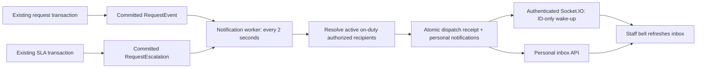

# Staff notifications — Phase 1

Implemented in the existing Express/Prisma backend and React staff workspace. No extra backend, frontend, Redis dependency, broker, or external notification provider was introduced. Patient and platform interfaces are not notification recipients in this phase.

## Existing capabilities and changes

The platform already had the transactional request state machine and immutable RequestEvent history, a PostgreSQL-backed RequestEscalation model, an operational SLA worker with configured thresholds, a scoped polling alert feed, optional sound/browser desktop alerts, and graceful server shutdown. It did not have a persistent personal inbox or Socket.IO transport.

Added a notifications domain with schemas, routes, controller, service, repository and realtime/worker integration. Existing request commands and assignment eligibility are reused, not duplicated or replaced. Notifications do not assign requests or change their state.

## Data flow and reliability



The existing committed events are the durable source queue. An anti-join against dispatch receipts discovers unprocessed sources, including late commits; no timestamp watermark can accidentally skip one. Per-source PostgreSQL advisory transaction locks serialize competing workers. Receipt and recipient notifications commit together; the unique `(hospitalId, membershipId, sourceKey)` index is an additional duplicate backstop. A failed transaction creates no partial notifications. Request submission succeeds independently because notification processing occurs later, not inside the patient transaction.

`NotificationDispatch` records CREATED, NO_RECIPIENT, NOT_ACTIONABLE, HISTORICAL_SKIP or RETRY. A missing recipient is recorded and warned once, not silently discarded. It is not automatically assigned to unrelated staff, and going on duty later does not replay a completed NO_RECIPIENT receipt; the existing live queue remains the operational fallback. Resolve staffing/configuration issues in response to the warning.

Processing and realtime delivery use persisted retry state and exponential delays capped at five minutes. Database outages leave the original committed source intact. Failed sources/deliveries do not prevent later sources from being processed. A crash after emission but before recording its attempt can re-emit the same ID; the frontend refreshes by ID and deduplicates inbox rows. An emission attempt is not a browser acknowledgement or a delivery guarantee. Socket.IO itself does not persist missed server events; recovery is implemented through PostgreSQL and the inbox API ([Socket.IO delivery documentation](https://socket.io/docs/v4/delivery-guarantees/)).

Inbox refresh happens on connection/reconnection and every 30 seconds as a transport-outage fallback. Closing the app does not remove notifications. Initial sign-in loads the inbox quietly, avoiding a sound storm for old unread messages. Marking read changes only readAt, never ACCEPTED or any request state.

## Recipient policy

All recipients must have an active membership and user, an active scoped role, no mandatory pending password change, and ON_DUTY status. Hospital and client must be active. Permission scopes are evaluated with existing authorization helpers and trusted database records; matching multiple roles does not duplicate a recipient. The staff actor is omitted from their own event.

| Event | Recipients |
|---|---|
| SUBMITTED | On-duty managers with request.read and request.assign covering the floor, ward or department; not every hospital user |
| ASSIGNED / TRANSFERRED | Current newly assigned staff only, still eligible under the existing department/coverage/duty rules, with scoped read/accept permission; stale former assignees are excluded |
| COMPLETED | Authorized on-duty managers who can confirm/close that work |
| CANCELLED | Authorized on-duty managers and current owner who may read that request |
| REJECTED | Authorized on-duty managers who can handle the outcome |
| Configured escalation | For ASSIGNEE: current eligible owner; for ROLE: holders of that exact configured active role, scoped to this work and authorized to manage it |

Ordinary care staff currently cannot read unassigned work. This implementation deliberately preserves that policy: they receive their assignment notification, not an actionable link to another person's or an unassigned request. Accepted, started and closed events are processed as NOT_ACTIONABLE rather than sending noise to unrelated staff.

Titles and messages are generic, without patient names, bed numbers, service descriptions or medical details. Socket payloads contain only the notification ID. An opaque request reference/link is returned by the inbox API only if the request is currently visible under the existing request-read policy; access is rechecked again by the request queue API after following the link. Transfer/scope changes can therefore remove a former owner's link without deleting their safe notification history. Existing browser desktop alert bodies were also changed to generic text.

## Database and API

Additive migration: `services/prisma/migrations/20261012120000_16_staff_notifications/migration.sql`.

- StaffNotification: ID, hospital/membership, source/type/priority, safe title/message, entity reference, creation/read timestamps and realtime attempt/retry state.
- Composite membership foreign key enforces hospital ownership. User identity is obtained through the membership, not a client recipient ID.
- NotificationDispatch: durable per-source receipt/outcome, recipient count, processing/retry timestamps and attempt count.
- Existing historical request/event records are marked HISTORICAL_SKIP during rollout to avoid flooding inboxes. New records after migration are processed normally. Old escalation records remain available in the existing alert feed, not backfilled as new inbox alerts.

Authenticated staff endpoints, derived exclusively from their session:

- GET `/admin/notifications?limit=20&before=<notification UUID>&unread=true`: own keyset-paginated inbox and complete unread count; limit 1–50, optional unread=true/false. Foreign/unknown cursors return 404.
- GET `/admin/notifications/unread-count`: own unread count.
- POST `/admin/notifications/:id/read` with `{}`: idempotent read action; foreign/unknown notification IDs return 404. No mark-all action in this version.

The request queue gains an optional validated `id` filter for the inbox link, without changing default list behavior. It uses the same authorized request scope and can show the selected request even if its status changed between the notification and the click.

## Socket security and lifecycle

Socket.IO attaches to the existing HTTP server at `/socket.io`. The handshake accepts only an existing staff token in `auth.token`. Guest/platform tokens, invalid/expired/revoked sessions, suspended accounts/hospitals and mandatory password changes are rejected by the existing StaffAuthService. Origins use the existing allowlist, including WebSocket upgrades. No client join/subscribe or creation handlers exist.

Rooms are server-derived `inbox:<hospitalId>:<membershipId>`. Session validity is checked again before every emission, and idle connections are revalidated every 30 seconds. Logout/revocation prevents further emission; the periodic check closes an otherwise idle revoked connection. Socket transports disconnect before HTTP drain, then workers and transport resources close before Prisma.

The production target remains one backend process. Competing notification/escalation workers are safe at the database level, but the Socket.IO adapter is process-local: horizontal realtime fanout is not guaranteed across instances. The persistent API/30-second polling fallback still works. Do not claim instant multi-instance fanout without adding an appropriate shared transport strategy in a later phase.

## SLA integration

The existing scheduler remains enabled by ESCALATION_INTERVAL_SECONDS (default 60; 0 disables it). Only configured policies/thresholds are executed; no new thresholds or supervisor targets were invented. Relative UTC deadlines need no hospital-day calculation. Existing hospital-local date handling is unchanged.

Improved the worker to scan stable bounded batches, avoiding starvation after the first 500 overdue rows. A row lock checks the request's actual waiting status and deadline before persisting a step, preventing stale scans from escalating a completed/cancelled or changed request. Level flags never decrease due to a competing worker. Existing unique per-request/stage/level records, system audits and non-overlapping scheduler lifecycle remain. Notification dispatch consumes those persisted escalation steps independently and retries after restart.

## Local setup and hosting

No new environment variables are required. Stop your own backend before applying the migration, from `services/`:

```bash
npm run prisma:migrate
npm run prisma:generate
npm run prisma:status
npm run dev
```

Ensure Node 24 is active and managers/receiving staff are on duty. Set escalation policies on applicable services; no policy means no configured escalation notification. Sound uses the existing Requests → Sound preference and browser interaction/autoplay rules. Native desktop permission is only requested by the existing explicit user action; no Web Push subscriptions or service-worker delivery were added.

Local Vite proxies `/socket.io` including upgrades to the existing backend on 3001, alongside `/api`. Production uses VITE_API_URL to connect directly to the API host; the built CSP includes only that API's corresponding ws/wss origin. PUBLIC_APP_URL/CORS_ORIGINS must match the frontend origins. Existing Render/Vercel hosting architecture is unchanged; any additional proxy must forward `/socket.io` and WebSocket upgrades. No live hosting deployment, hosting-plan changes or production verification was performed.

## Verification

See the implementation results below. Tests use only TEST_DATABASE_URL on an isolated disposable PostgreSQL cluster. No development/production schema or data was mutated. The generated ER diagram includes the new models.

Manual acceptance: sign in an on-duty scoped manager on one device and assigned staff on another, submit via bedside QR, observe the bell and assignment inbox, mark read (verify request remains ASSIGNED), follow its link and finish work, verify completion reaches the manager, disconnect/reconnect and refresh to check persistence, and test overdue configured ROLE/ASSIGNEE targets. Repeat with another hospital and an unrelated floor/department. Validate sound after an explicit interaction on real target phones; no sound is essential to delivery.

Deferred: Web Push, SMS, WhatsApp, external vendors, automatic assignment, retention/purge policy and multi-instance instant fanout. No medical emergency workflow is implied by alerts.

## Files changed

Backend: notifications module; app/container/server composition; minimal scope-helper type signatures/public request-scope export; optional request queue ID filter; escalation repository/service locking and batching; Prisma schema/new migration; integration and browser-fixture tests; Socket.IO dependencies/lockfile.

Frontend: notifications API and bell/inbox feature; staff navbar integration; selected-request queue link/filter; focused inbox styles; Socket.IO dependency/lockfile; Vite socket proxy/build CSP; generic existing desktop alert body; component/security/alert tests and the existing browser care-flow test. Existing patient/platform screens and unrelated domain behavior were not redesigned.

### Final verification results

Verified on 2026-10-12 using Node 24 and a disposable PostgreSQL database:

| Check | Result |
|---|---|
| All 16 migrations on a fresh isolated database | Passed |
| Backend unit tests (`npm test`) | 36 passed across 8 files |
| Backend integration tests (`npm run test:integration`) | 166 passed across 19 files |
| Frontend interaction tests (`npm test`) | 123 passed across 21 files |
| Chromium production-build end-to-end tests (`npm run test:e2e`) | 8 passed |
| Both apps: formatting, lint, typecheck and build | Passed |
| Prisma schema validation and generated ER diagram check | Passed |

Integration tests cover authorization, recipient scope/duty, concurrency/deduplication, stale assignments, persistent source and delivery retries, read isolation, reconnect recovery and SLA behavior. Browser tests cover the existing care workflow plus the inbox, mobile overflow, read persistence and request navigation. Early fixture failures and a UTC/session-timezone deadline mismatch were corrected and the full suites rerun; sandbox-only HTTP binding restrictions were resolved by rerunning the checks with local network permission.

Real hosted proxies, physical phone camera/audio behavior and closed-browser delivery were not verified. The disposable test cluster was stopped and removed after verification. No development or production migration was applied by this task; apply migration 16 before starting the updated backend.
